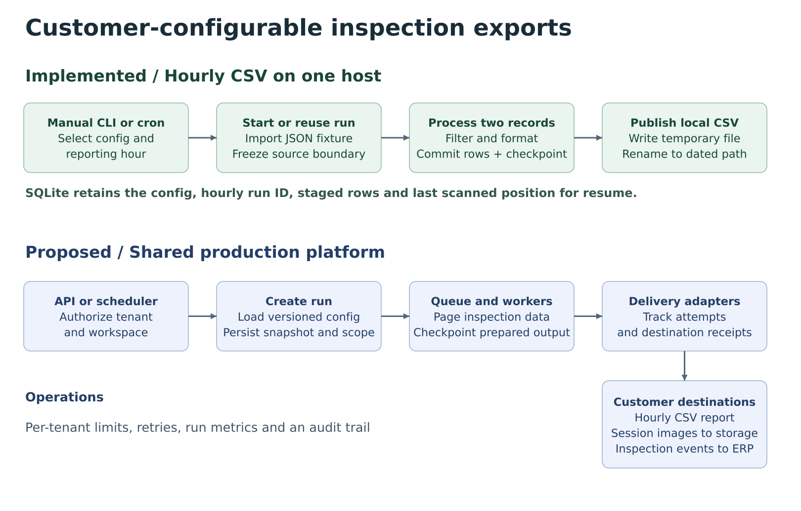

# Customer-configurable data export platform

## Purpose

Loopr AI customers need inspection data in their own systems. One customer may need images copied to object storage, another may need a scheduled CSV report, and another may need inspection events sent to an ERP. The platform keeps these differences in tenant-owned export configuration while the core product retains a shared export workflow.

This document describes the proposed production architecture and the CSV report slice implemented in this repository.

[Editable draw.io diagram](architecture.drawio)

## Scope and assumptions

- A tenant is a Loopr AI customer. A tenant owns one or more workspaces. A workspace contains inspection sessions and their inspection records.
- Inspection records have stable unique IDs and an ordering field such as creation time plus ID. Records are append-only for the duration of an export.
- Each export run has a fixed source boundary captured when it starts. The CSV worker ignores records appended beyond that position. An inspection that arrives after its reporting hour was published requires a separate backfill to correct that report.
- Customers manage their export configuration through Loopr AI. They do not provide arbitrary code to execute.
- The production design uses durable object storage, a managed queue, and a relational run store. The local CLI imports a JSON fixture into SQLite, saves run state there, and delivers a local CSV.

## Proposed production architecture

The platform has one shared control path and destination-specific delivery adapters.

1. The Export API accepts a configuration change or manual export request. The scheduler invokes the same API for periodic exports.
2. Configuration validation checks the allowed fields, filters, transforms, destination type, tenant ownership, and secret references.
3. The service creates a run with a fixed configuration snapshot and source boundary. Its status and checkpoint advance as work completes.
4. A queue gives the run to a worker. The worker reads source records in bounded batches after its checkpoint.
5. The worker applies the configuration’s filters and transformations. It writes prepared output and advances the checkpoint together.
6. A destination adapter delivers the result. The run store records each delivery attempt and its outcome.
7. Operators and customers can query run status, counts, failures, and an audit trail.

### Customer configuration

Configuration is data rather than customer-specific application code. The proposed production registry stores the following settings:

- Tenant and workspace scope
- Optional session scope
- Field selection and column headings
- Filters and approved value transforms
- Destination type and destination-specific settings
- Schedule and time zone when the export is recurring
- A version and an activation state

In the CLI, JSON defines scope, columns, filters, transforms and the local destination. Cron owns the schedule. SQLite stores the validated JSON with each run. Configuration versions and activation states belong to the proposed registry.

The configuration schema is deliberately limited to known fields and transforms. This gives customers useful flexibility while avoiding an unbounded scripting environment with unpredictable cost and security behavior.

### Shared components

| Component | Responsibility |
| --- | --- |
| Export API and scheduler | Creates runs from a manual request or schedule and enforces tenant access. |
| Configuration registry | Stores versioned configurations and secret references. |
| Run store | Stores immutable run snapshots, source boundaries, checkpoints, output manifests, statuses, and errors. |
| Queue and workers | Performs long-running export work outside request handling, with tenant-aware concurrency limits. |
| Inspection data access | Reads records consistently and resolves image references. |
| Destination adapters | Encapsulate delivery behavior for object storage, CSV, and ERP APIs. |
| Observability and audit log | Exposes progress, structured errors, metrics, alerts, and traceable actions. |

## Scenario support

### Images in object storage

An object-storage configuration specifies an allowed customer bucket or prefix, session-based path template, inclusion rules, and a naming convention. The image adapter creates a manifest of selected image references, resolves each reference through a storage locator, then copies the available images. Missing or temporarily unavailable images become per-item errors in the manifest. The run can retry those items without copying successful images again.

The storage locator isolates changes in image storage. New image references may resolve directly to the current location. Older references can resolve through a legacy lookup or migration map. The adapter receives a stable source reference and does not need customer-specific storage logic.

### Scheduled CSV reports

A production CSV configuration specifies its schedule, scoped source query, columns, headings, filters, transforms, and destination. The prototype uses a user cron entry to invoke the CLI for the preceding UTC hour. SQLite stores one run per tenant, configuration name, and hour. Resuming uses the original data boundary, reporting hour, and dated local output path.

### Inspection events to an ERP

An ERP configuration specifies the endpoint, authentication-secret reference, payload mapping version, event selection, and allowed rate. The ERP adapter sends records in supported batch sizes with a stable idempotency key derived from the export run and record ID. It treats timeouts and retryable responses differently from permanent validation errors. Rate limiting and exponential backoff prevent one ERP from consuming all worker capacity.

## Implemented CSV lifecycle and failure example

1. With the cron entry installed, the 09:00 UTC trigger starts the 08:00 report. The CLI validates the JSON config. On a new run it saves the config, the source boundary (position 8 in the fixture), the hour and the dated output path. The worker includes inspections with `08:00 <= inspectedAt < 09:00` UTC.
2. The worker scans inspections 001 and 002. Only 002 matches the failures filter. SQLite commits its formatted row and checkpoint 2 together.
3. The recovery demo exercises the same worker in a manual run. It forces an error after row 004 is staged and before checkpoint 4 is saved. The transaction rolls back. Row 002 and checkpoint 2 survive.
4. A fresh CLI process resumes the saved run from inspection 003. After scanning all eight records it publishes one header and four rows. The demo compares the recovered CSV byte for byte with an uninterrupted export.

For external destinations, a timeout can leave delivery uncertain. The proposed adapters track attempts and acknowledgements and reuse delivery keys where the destination supports them. If the ERP cannot deduplicate or confirm acceptance, an operator must reconcile an ambiguous delivery before replaying it.

## Reliability and data correctness

Each run snapshots the configuration and source boundary. A customer editing a configuration does not change an in-progress export. A customer can create a new run with the new version.

The worker processes a bounded, ordered batch and commits its prepared output and checkpoint atomically. A batch can be retried without losing already committed progress. The final destination is published only after all batches complete. For destinations that cannot provide atomic publish, the adapter exposes a manifest and a completion marker so consumers can identify a complete export.

The prototype imports the append-only sample into SQLite when starting a run. Each batch reads up to two inspections in sequence order through the run’s fixed boundary. One transaction stages matching CSV rows keyed by run ID and source sequence and advances the checkpoint through every inspected row. Resume reads the saved config and continues after the checkpoint. Publication streams the staged rows to a temporary file and renames it before committing the completed status. A crash between rename and commit can repeat publication with identical contents. Distinct manual runs targeting one path still replace the previous report.

## Scale and operations

**Operating the CLI.** Repeating an hourly trigger reuses the same run. A completed or running run is skipped, and a failed run is retried. After a hard stop, confirm the old process has exited and use `--resume <run-id>` with the original SQLite file. Cron requires an awake host. Use `--hourly --hour` to replay a missed hour. The fixture import reads the entire JSON array into memory. Only the subsequent scan and publication are incremental.

Production workers stream or page records and images instead of loading an entire export into memory. The source query uses a stable order and index appropriate to tenant, workspace, source boundary, and record ID. CSV data is staged in chunks. Image copies use bounded concurrency and per-tenant quotas.

The scheduler creates one run per eligible configuration while preventing overlapping runs for the same configuration unless explicitly allowed. Queue fairness and concurrency limits keep a large customer export from starving others.

Metrics include run duration, records scanned and delivered, bytes transferred, retry count, queue age, destination latency, and failure count. Logs include tenant ID, export configuration ID, run ID, destination adapter, and error category. Alerts cover repeated destination failures, growing queue age, and unusually high failure rates.

## Security and tenant isolation

The local CLI trusts the operator. Its tenant and workspace filters select records according to the supplied configuration. In production every configuration and run is tenant-scoped. The Export API authorizes configuration changes and export requests against the caller’s tenant and workspace access. Workers query only the scope frozen into the run. Destination credentials are held in a secret manager and referenced by ID, never stored in configuration as plain text.

Destination allowlists prevent a configuration from delivering data to arbitrary locations. Sensitive values are redacted from logs. Data is encrypted in transit and at rest. Audit records retain configuration changes, run starts, delivery attempts, and operator actions.

## Extending the platform

A new destination adds an adapter contract that defines configuration validation, capability checks, delivery behavior, retry classification, idempotency strategy, and observability fields. A new transform adds a named, reviewed operation to the transform registry. Both additions keep the shared run lifecycle unchanged.

Some customer requests do require core product changes. Examples include a new data field that the product does not retain, a new destination protocol, a transform with significant compute requirements, or a delivery guarantee unavailable from the destination. These changes become shared, versioned product capabilities rather than one-off customer branches.

## Changing an existing export safely

Assume an ERP customer uses payload version 1 and wants a renamed field with a new value format.

1. Add payload version 2 as a new configuration version or adapter mapping. Keep version 1 active.
2. Validate version 2 against representative historical records and a customer test endpoint.
3. Run version 2 in shadow mode or deliver it to a separate test destination. Compare counts, required fields, and sample payloads.
4. Agree on a cutover time. Start new scheduled runs with version 2 while retaining version 1 configuration and output manifests.
5. Monitor delivery outcomes and downstream acceptance. Roll back by reactivating version 1 for future runs.
6. Perform a separately approved backfill if historical data must use the new format. Backfills have their own source boundary, run ID, and output location.

Existing completed exports stay associated with their original configuration version. That preserves the ability to explain and reproduce historical output.

## Implemented slice

The TypeScript CLI supports manual exports, hourly cron triggers, and explicit replay of a reporting hour, with:

- JSON configuration validation through Zod
- Tenant, workspace, and optional session filtering
- Result and confidence filtering
- Approved uppercase, ISO date, and percentage transforms
- Safe local CSV output under output
- CLI feedback for successful exports and configuration errors
- Automated tests for report contents, formatting, scope isolation, invalid configurations, hourly window boundaries, repeat triggers, publication failures, and rollback and resume

From the repository root with Node.js 22.22.1:

~~~sh
npm ci
npm run export -- --config config/failed-inspections.json
npm run export -- --config config/high-confidence-inspections.json
npm run export -- --config config/failed-inspections.json --hourly --hour 2026-11-21T08:00:00Z
npm run demo:recovery
npm test
~~~

See the [README](../README.md) for expected files and cron setup.
